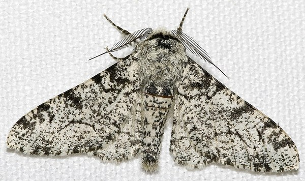
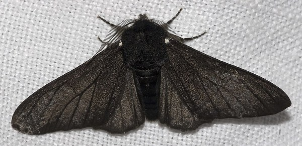

# Natural Selection: Camouflage — A Field Guide

*A demonstration by Ken Thompson, in four pages.*

## What the Demonstration Shows

There is, in every patch of ground and every reach of open water, a quiet and unending trial. The creature that stands out against its surroundings is seen, and what is seen is eaten. The creature that blends in lives a little longer, long enough to breed, and its children inherit the coloring that hid it.

This app stages that trial. A **population of 32 creatures** is laid out in a grid of 4 rows by 8 columns, set against a colored **background**. Each generation:

1. **A predator eats the 8 most visible creatures**, the ones whose coloring lies farthest from the background. The predator, a **red finch**, flies to each in turn, a songbird like those Kettlewell watched taking moths from tree trunks; on the Squirts page, where the prey are squid, it is a **red perch** that swims to them.
2. **8 more die at random**, whatever their color, because fortune keeps no ledger of merit. A **black skull stamp**, outlined in white, slams down on each, one at a time.
3. **The 16 survivors are shuffled and paired.** Each pair has four children, so the population is back to 32. Each child takes one gene from one parent and the other gene from the other parent (what those genes are depends on the page; see below).
4. **Mutation** (if it is on): each child has a 30% chance of a small random change to its genes.

Over the generations the population drifts toward the background color. Nobody steers it; selection does the work. That is the whole lesson.

## The Four Pages

All four pages live in `/workspace/natural-selection/` and link to one another through the links near the foot of each page.

| Page | Creatures | Genes | Distance measured as |
|---|---|---|---|
| `index.html` (Color) | Butterflies in full color | 24-bit RGB color, shown as `#RRGGBB`. Child takes the **hue** of one parent and the **saturation and value** of the other. | Straight-line distance in RGB space (0 to about 441.7) |
| `mono.html` (Monochrome) | Gray moths, drawn as a peppered moth (*Biston betularia*; `design/moth.svg`) | One 32-bit number (`00000000`–`FFFFFFFF`) drawn as a shade of gray. Child takes the **high 16 bits** of one parent and the **low 16 bits** of the other. | Absolute difference of the 32-bit numbers, shown in hex and as a percentage |
| `spots.html` (Spots) | White moths with gray spots, using the same peppered moth drawing | Two 32-bit genes: a **spot shade** (base gray of the spots) and a **spot pattern** (seed for how many spots, their sizes, positions and per-spot shade offsets). Each spot's center is redrawn until it lands inside the moth outline, then mirrored to the other side. Child takes the shade of one parent and the pattern of the other. | Difference between the moth's area-weighted average gray (wings and body) and the background gray, out of 255 and as a percentage |
| `squirts.html` (Squirts) | Squid in full color | Same as the Color page: hue from one parent, saturation and value from the other. | RGB distance, as on the Color page |

On the Spots page a mutation changes the shade gene (70% chance) and flips 1–3 random bits of the pattern gene (70% chance). On the Monochrome page it shifts the 32-bit gene by a small amount. On Color and Squirts it nudges hue by up to ±20° and saturation and value by up to ±0.075.

## Getting Under Way

1. Serve the folder (it is served now at `http://127.0.0.1:8766/`) and open `index.html`, or whichever page you want.
2. On load, the app gives you a random background and 32 random creatures, at **Generation 0**.
3. Press **Next generation** and watch it happen: the predator makes its rounds and the skulls come down, which takes about six or seven seconds, then the survivors' children take their places.
4. Once you have seen the mechanism, set a number in the box and press **Run N generations** to go much faster.
5. Watch the **Avg distance from background** number below the grid fall.

## The Controls

### On every page

- **Next generation** (`#step`): Runs one generation with the marks shown. The red finch (a red perch on Squirts) visits each creature it eats, and a black skull stamps down on each one lost to chance, over about 6 to 7 seconds, with the controls locked meanwhile; then the grid is redrawn with the new brood and the generation count goes up by one. Wait for the redraw before pressing again. If your system asks for reduced motion, the predator does not fly or swim and the stamps do not slam: the marks and skulls appear all at once, and the new brood follows after about one and a half seconds.
- **Generation count box** (`#n`): A number field, set to **10** by default (minimum 1). It sets how many generations the next button runs. An empty or zero value counts as 1.
- **Run N generations** (`#multi`): Runs that many generations at once with no marks and no pause, then shows only the final population. Very large numbers can make the page pause for a moment, especially on the Spots page.
- **Reset** (`#reset`): Starts over: a new random background, 32 new random creatures, generation back to 0.
- **Mutation** (`#mut`): A checkbox, **on** by default. When on, each child has a 30% chance of a small random change to its genes. When off, children only recombine their parents' genes, so the population can never get closer than the best mix of genes already present.
- **Version links**: Links to the other pages (Color, Monochrome, Spots, Squirts). Each page starts fresh; nothing carries over.

### Spots page only

- **Background gray slider** (`#bgs`): A range from 0 (black) to 255 (white). Dragging it changes the background gray **right away, without resetting** the population or generation count, so you can change the creatures' environment mid-run and watch them adapt.
- **Random background** (`#rbg`): Picks a new random gray background straight away, also without a reset. The slider moves to match.

### Squirts page only

- **Hue slider** (`#hue`, labelled *Hue*): A range from 0 to 360 over a rainbow track. It sets the background's hue live, without a reset.
- **Value slider** (`#val`, labelled *Value*): A range from 0 to 100. Its track goes from **white at 0**, through the **full hue at 50**, to **black at 100**; the track updates to show the current hue. It changes the background live, without a reset.

On Reset, both sliders move to match the new random background.

## What You See

- **Background label** (`#bglabel`): Shows `Background: ` followed by the background gene: `#RRGGBB` on the Color and Squirts pages, and the 32-bit gene as eight hex digits on the Monochrome and Spots pages.
- **The grid** (`#grid`): The background color itself, with the 32 creatures (`#grid > div.org`) arranged in 4 rows of 8. Under each creature is its **% match to the background**, rounded to one decimal place, where 100% means identical. The label text turns black or white, whichever is easier to read against the background. The match is computed per page:
  - **Color and Squirts:** 100 × (1 − *d* / (255 × √3)), where *d* is the straight-line (Euclidean) distance between the creature's and the background's RGB colors.
  - **Monochrome:** 100 × (1 − |gene − background gene| / `0xFFFFFFFF`).
  - **Spots:** a single number, 100 × (1 − |area-weighted average moth gray − background gray| / 255), averaged over the wings and body.
- **Statistics line** (`#stats`): `Generation N | Avg distance from background: X`. **Lower is better camouflage.** The Monochrome page shows it in hex and as a percentage; the Spots page shows it out of 255 and as a percentage.

## What to Watch For

- **The fall of the distance figure.** It usually drops quickly over the first few dozen generations, then levels off as the creatures get close to the background.
- **The bird at work.** In single steps, notice that the ones the red finch visits are always the most conspicuous, while the skulls fall anywhere, sometimes on the best-hidden creatures. Selection works on averages, not on individuals.
- **Mutation turned off.** Reset, uncheck Mutation, and run a hundred generations. The population gets stuck at the best combination its starting genes allow. Turn mutation back on and it starts creeping closer again.
- **A change of scene.** On the Spots or Squirts pages, let a population adapt, then move the background slider. The distance figure jumps, and the population has to adapt again.
- **Spots that hide by average.** On the Spots page the predator judges only the overall average gray of the moth (wings and body), so very different spot patterns can be equally well hidden.

## Tips

- Use **Next generation** to see how it works, and **Run N generations** to see the result over time.
- Start with N around 10–50; raise it once you know how fast your browser handles it.
- A mid-gray or mid-tone background makes the convergence easiest to see; on near-black or near-white backgrounds the creatures may already be close.
- The demo is random: two runs with the same settings will go differently. Run it a few times before drawing conclusions.
- Nothing is saved. Reloading the page is the same as pressing Reset.

## The Real-World Case: Kettlewell's Peppered Moths

### The moth and the soot

The peppered moth, *Biston betularia*, rests by day on trees, and the birds hunt it there. Its common form, *typica*, is pale and finely speckled with black, like lichen on bark. During the Industrial Revolution a black form, *carbonaria*, became common in Britain. Since about 1970, as the air has cleared, it has declined again [[3]](#references). For much of the twentieth century the explanation was camouflage. On trunks darkened by soot the black moth was hard to see and the pale one stood out; on clean, lichen-covered bark the opposite was true. Birds, hunting by eye, would do the rest.

|  |  |
|:---:|:---:|
| *Biston betularia* f. *typica*, the pale, speckled form | *Biston betularia* f. *carbonaria*, the black (melanic) form |

Photos: [Olaf Leillinger](https://de.wikipedia.org/wiki/Benutzer:Olei) (Wikimedia Commons user Olei), cropped by Chiswick Chap, via Wikimedia Commons: [*typica*](https://commons.wikimedia.org/wiki/File:Biston.betularia.7200.jpg) and [*carbonaria*](https://commons.wikimedia.org/wiki/File:Biston.betularia.f.carbonaria.7209.jpg). Licensed under [CC BY-SA 3.0](https://creativecommons.org/licenses/by-sa/3.0/); resized to 600 px wide for this guide.

It was a plausible story, and plausibility is not proof. In the 1950s the Oxford entomologist H. B. D. Kettlewell set out to test it in the woods themselves.

### What Kettlewell did

Kettlewell used **mark-release-recapture**. He marked moths of each form with a small dot of quick-drying paint on the underside, hidden when the moth is at rest, released them onto trunks and boughs in a wood, and caught as many as he could again over the following nights with a mercury-vapor light trap and with traps baited with virgin females. Only males were counted in the recapture results, because females could not be recaptured. If one form disappears faster than the other, presumably because it was eaten, fewer of it come back [[1]](#references), [[2]](#references).

He worked in two contrasting places:

- **A polluted wood near Birmingham:** the Christopher Cadbury Bird Reserve near Rubery, about six miles from the industrial area. *Carbonaria* made up about 85% of the local moths he caught there in 1953 [[1]](#references).
- **An unpolluted wood in Dorset:** Deanend Wood, heavily covered in lichen, where *carbonaria* was rare or absent [[2]](#references).

He ran the Birmingham experiment in 1953 and again in 1955, and the Dorset experiment in 1955 [[1]](#references), [[2]](#references). He also scored each released moth by eye as conspicuous or inconspicuous against its background. He then watched what happened to the moths, and in 1955 the ethologist **Niko Tinbergen** joined him to observe and film the birds from hides. The moths used for the filmed observations were not counted in the recapture figures [[2]](#references).

### What he found

| Site and year | *carbonaria* (dark) recaptured | *typica* (light) recaptured | Source |
|---|---|---|---|
| Birmingham, 1953 | 123 of 447 (27.5%) | 18 of 137 (13.0%) | [[1]](#references) |
| Birmingham, 1955 | 82 of 154 | 16 of 64 | [[2]](#references) |
| Dorset, 1955 | 30 of 473 (6.3%) | 62 of 496 (12.5%) | [[2]](#references) |

In Birmingham, about twice as many of the dark form came back as of the light. In Dorset the result reversed. Kettlewell reported that, after excluding three biased release days, three times as many *typica* as *carbonaria* were recaptured [[2]](#references).

The direct observations told the same story. In Birmingham in 1955, Tinbergen recorded a pair of redstarts and their young taking 43 *typica* to 15 *carbonaria* when both forms were offered in equal numbers. In Dorset, five species of birds were watched taking 190 moths: 164 *carbonaria* and 26 *typica* [[2]](#references). In both woods, the form that stood out against its bark was the one the birds found.

### How this connects to the demo

The demo turns Kettlewell's woods into a grid, and on the Monochrome and Spots pages its creatures are drawn as peppered moths (`design/moth.svg`). The **background** stands in for the bark, and the **predator** stands in for the birds: each generation it removes the creatures that differ most from the background. The ones that remain breed, and over the generations the population shifts toward the background color. Moving the slider on the Spots or Squirts page is a small version of the change from soot to clean bark: what was hidden becomes conspicuous, and selection runs the other way.

### Where the demo simplifies

The demo keeps the logic of the real case but leaves out a great deal:

- **A fixed kill count.** The predator always takes exactly 8 creatures, the 8 farthest from the background, every generation. Real birds miss well-hidden moths and sometimes catch obvious ones. Predation is a matter of probabilities, and its strength varies from year to year [[3]](#references).
- **Fixed random deaths.** Exactly 8 more die at random each generation. Real mortality from other causes is neither fixed nor neatly separated from predation.
- **Different inheritance.** In the demo, a creature's color is assembled from parts of both parents: hue from one and saturation and value from the other, or high bits from one and low bits from the other, or spot shade from one and pattern from the other. Mutation then nudges the result. Offspring therefore land between or near their parents, much like blending inheritance. In the real moth, *carbonaria* is inherited through a **single dominant allele at one locus** [[3]](#references). That mutation has been traced to a transposable element inserted into the gene *cortex*, estimated to have arisen around 1819 [[4]](#references). A real moth is essentially one form or the other, not a mix.
- **No migration.** No creatures enter or leave the grid. Real moths fly between woods, and migration has been argued to play a part in the history of melanism [[3]](#references).
- **A still world.** The background never changes by itself. It changes only when you press **Reset**, or move the sliders on the Spots and Squirts pages. In Britain, pollution rose and then fell over more than a century.
- **Other simplifications.** The population size stays at 32, generations are discrete and do not overlap, and "visibility" is a distance computed on screen colors, not what a bird's eye actually sees.

### Criticism

Kettlewell's experiments became textbook material, and they also drew criticism. Critics pointed out that:

- **Resting positions.** Moths were released onto tree trunks, which some argued were not where peppered moths normally spend the day. Experiments with dead moths pinned to trunks seemed even less natural [[3]](#references).
- **Release densities.** Moths were often released at far higher densities than occur in the wild, which might make birds hunt them more intensively [[3]](#references). Kettlewell himself acknowledged in 1955 that his releases produced concentrations that free moths would have avoided, and that natural predation, "though selective, might take place at a lower tempo" [[1]](#references).
- **Reared moths.** Moths reared in captivity, sometimes from distant sources, were used alongside wild ones, and may not have behaved naturally [[3]](#references).

By the 1990s these doubts were widely aired, and they were taken up by opponents of evolution. Journalist Judith Hooper's 2002 book *Of Moths and Men* went further [[5]](#references). It argued that Kettlewell's results were fraudulent and suggested that bats rather than birds might be the agents of selection. Biologists rejected the fraud charge; Cook and colleagues describe it as "quite groundless" [[3]](#references), [[6]](#references).

### Majerus's last experiment

Michael Majerus, an evolutionary geneticist at the University of Cambridge, set out to answer the critics directly. From 2001 to 2007, in a 1-hectare rural garden at Springfield, near Coton, Cambridgeshire, he carried out two pieces of work [[3]](#references):

- **Where wild moths actually rest.** While climbing trees in the garden, he recorded the resting positions of 135 wild moths. 52% were on lateral branches, 35% on tree trunks, and 13% under or among twigs. This showed that trunks are a normal resting site.
- **A low-density predation experiment.** Over six seasons he released **4,864 moths**, one per night into each of 12 netting sleeves around branches chosen at random. Release density averaged fewer than 10 moths per hectare per night. The mix of dark and light moths was set close to local frequencies, and the moths were released onto branches, a resting site Majerus had shown to be normal for the species. Moths still missing four hours after sunrise were presumed eaten. Nine species of birds were seen eating them, and about a quarter of the disappearances were directly observed as bird predation.
- **Bats.** He also released moths at night and found no significant difference between the forms among 419 moths eaten by pipistrelle bats.

Majerus died in 2009, before he could publish. His colleagues L. M. Cook, B. S. Grant, I. J. Saccheri and J. Mallet analyzed his data and published it in 2012 in *Biology Letters* [[3]](#references). They found strong, statistically significant bird predation against *carbonaria* at this unpolluted site. The estimated daily selection coefficient was *s* = 0.091 (95% CI 0.028–0.157), which means a melanic moth's daily survival was about 91% of a pale moth's. That is enough to explain the decline of melanism in post-industrial Britain. The authors concluded that this provides "the most direct evidence yet to implicate camouflage and bird predation as the overriding explanation for the rise and fall of melanism in moths" [[3]](#references).

The demo is a toy of that conclusion. It is a crude one: thirty-two creatures, a grid, a fixed tally of the dead. Still, it obeys the same rule the birds of Birmingham and Dorset obeyed: whatever stands out against the world is found, and whatever matches it endures.

## References

1. Kettlewell, H. B. D. (1955). Selection experiments on industrial melanism in the Lepidoptera. *Heredity*, 9(3), 323–342. [doi:10.1038/hdy.1955.36](https://doi.org/10.1038/hdy.1955.36)
2. Kettlewell, H. B. D. (1956). Further selection experiments on industrial melanism in the Lepidoptera. *Heredity*, 10(3), 287–301. [doi:10.1038/hdy.1956.28](https://doi.org/10.1038/hdy.1956.28)
3. Cook, L. M., Grant, B. S., Saccheri, I. J., & Mallet, J. (2012). Selective bird predation on the peppered moth: the last experiment of Michael Majerus. *Biology Letters*, 8(4), 609–612. [doi:10.1098/rsbl.2011.1136](https://doi.org/10.1098/rsbl.2011.1136)
4. van't Hof, A. E., Campagne, P., Rigden, D. J., Yung, C. J., Lingley, J., Quail, M. A., Hall, N., Darby, A. C., & Saccheri, I. J. (2016). The industrial melanism mutation in British peppered moths is a transposable element. *Nature*, 534(7605), 102–105. [doi:10.1038/nature17951](https://doi.org/10.1038/nature17951)
5. Hooper, J. (2002). *Of Moths and Men: Intrigue, Tragedy and the Peppered Moth*. London: Fourth Estate. (US edition: *Of Moths and Men: An Evolutionary Tale*. New York: W. W. Norton.)
6. Grant, B. S. (2002). Sour grapes of wrath. *Science*, 297(5583), 940–941. [doi:10.1126/science.1073593](https://doi.org/10.1126/science.1073593)
